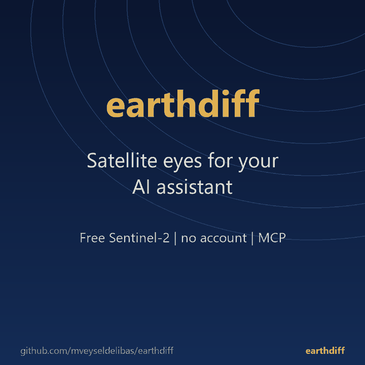
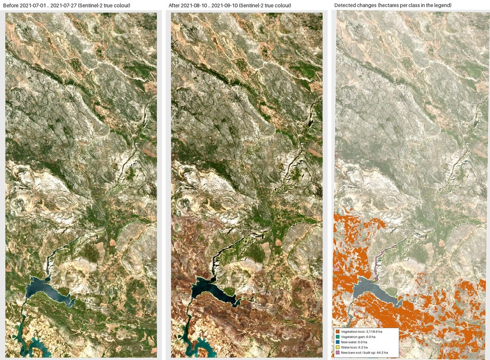
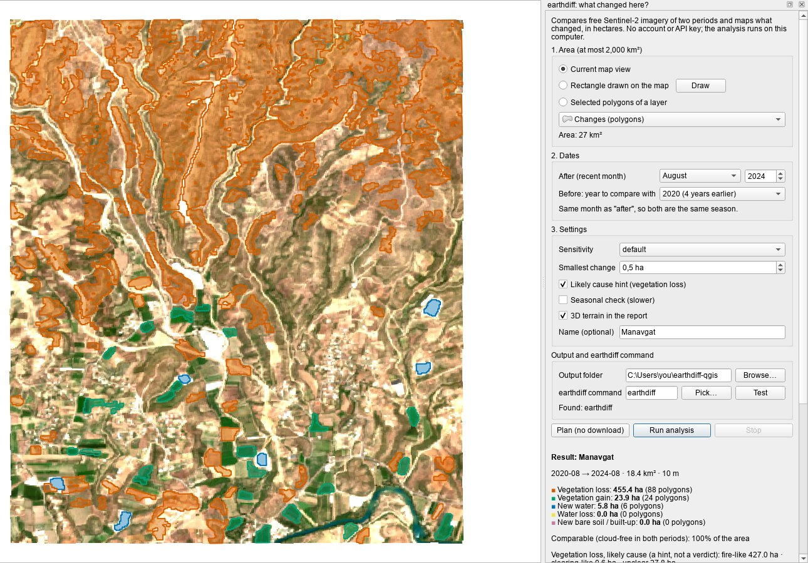
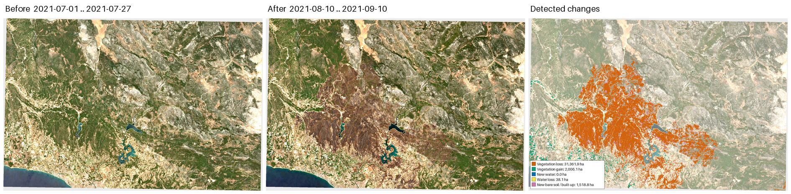
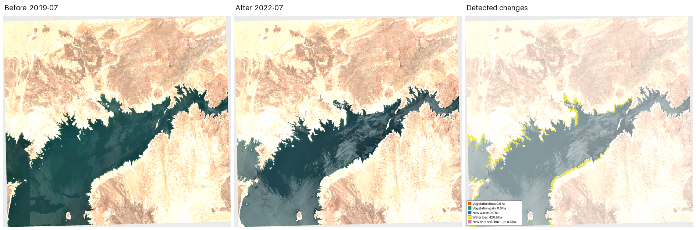
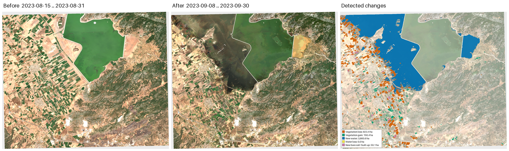
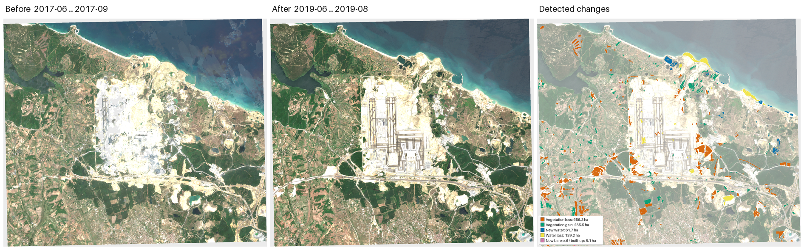
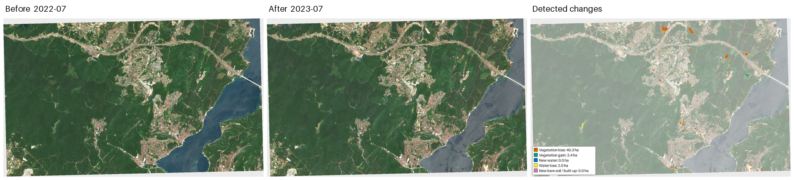

# earthdiff

<!-- mcp-name: io.github.mveyseldelibas/earthdiff -->

**Satellite eyes for your AI assistant: "what changed here?" answered from free Sentinel-2 imagery, with before/after images, a change map, hectares, confidence and limits.**
No account, no API key, no paid service, no black-box model. Works as an [MCP](https://modelcontextprotocol.io) server (Claude Desktop, Claude Code, Cursor, any MCP client) and as a command line tool.



*The GIF is built by `scripts/make_demo_gif.py` from the literal outputs of the MCP tools (`validation/mcp/`).*

**Try a report in your browser, nothing to install:** [example report, Manavgat August 2020 vs August 2024](https://huggingface.co/spaces/mvdelibas/earthdiff-demo) (swipe, scene by scene, 3D, searchable table; Turkish and English).

**Türkçe:** [MCP kurulumu ve kullanım aşağıda](#türkçe)

## Use it from your AI assistant in 30 seconds

Requires [uv](https://docs.astral.sh/uv/) (it installs Python and the packages on first start; the first start downloads about 200 MB of geo libraries).

**Claude Code**

```bash
claude mcp add earthdiff -- uvx --from "earthdiff[mcp]" earthdiff-mcp
```

**Claude Desktop**: edit `claude_desktop_config.json` (macOS `~/Library/Application Support/Claude/`, Windows `%APPDATA%\Claude\`) and restart.

**Cursor**: `~/.cursor/mcp.json` (or `.cursor/mcp.json` in a project). Same block:

```json
{
  "mcpServers": {
    "earthdiff": {
      "command": "uvx",
      "args": ["--from", "earthdiff[mcp]", "earthdiff-mcp"],
      "env": { "EARTHDIFF_OUTPUT_DIR": "C:/Users/you/earthdiff-output" }
    }
  }
}
```

From a clone instead of PyPI: `pip install -e ".[mcp]"` and use `"command": "earthdiff-mcp"` (or `python -m earthdiff.mcp_server`). Check the setup with `earthdiff-mcp --check`.

Then ask, for example:

> *"What changed around Manavgat after the July 2021 wildfire?"*
> *"How did Lake Mead change between July 2019 and July 2022?"*
> *"Compare this April with last April around Lake X."* (leave `before` empty: it defaults to the same period one year earlier)

### What the assistant does and what you get

1. `find_place` turns the name into a bounding box (OpenStreetMap Nominatim). It does **not** guess: Manavgat returned the district (about 5,750 km2, larger than the 2,000 km2 limit) and the river, so the assistant is handed candidates and narrowing options and asks you.
2. `plan_change` (a few seconds, nothing downloaded) shows how many scenes exist and warns about season mismatch, clouds, few scenes.
3. `detect_change` (about 1 to 4 minutes, with progress notifications) returns the **before, after and change-map images**, hectares and polygon counts per class, the comparable share of the area, confidence, data quality, the largest changed areas and every warning. It writes `report.html` (interactive swipe map) and `changes.geojson` to your output folder and tells you where.



*The three images are exactly what the client receives (360 km2, 20 m, 2021-07 vs 2021-08/09, 99 s). Result: 3,119 ha vegetation loss in 291 polygons, 100 % comparable, confidence high (0.80), no warnings. Context and caveats in [validation/mcp_questions.md](validation/mcp_questions.md).*

An answer an assistant can write from that output (shortened):

> Between the July and August/September 2021 windows I found **3,119 ha of vegetation loss** (291 polygons) around the Manavgat reservoir, concentrated south of it; the dark scar is visible in the "after" image. 100 % of the area was cloud-free in both periods (8 scenes each), confidence is high (0.80, a heuristic, not a probability). No warnings. This says vegetation turned much less green, not why; a wildfire is consistent with the timing but this tool cannot prove it. It is a screening result, not an official burned-area figure; the box (360 km2) covers only part of the fire. *Contains modified Copernicus Sentinel data 2021.* Files: `report.html`, `changes.geojson` in your output folder.

### Tools

| Tool | What it does |
|---|---|
| `find_place` | Place name to bounding box(es). Several different places: returns candidates, never guesses. Box over the area limit: returns a centred box and tiles to choose from. Nominatim policy: User-Agent, at most 1 request/s, cache, attribution. `margin_km` adds the surroundings. |
| `plan_change` | Validates area and windows, searches scenes, **downloads nothing**. Scene counts and dates, grid size, expected runtime, warnings. |
| `detect_change` | The analysis (reuses the same pipeline as `earthdiff run`). Images, hectares and polygons per class, `likely_cause` hint for vegetation loss, optional `seasonal_check`, comparable share, confidence, bright-surface check, data quality, largest areas, warnings, file paths. |
| `explain_method` | The rules with thresholds, pipeline, how confidence is computed, limits, data and attribution. |

Parameters are validated and **unknown parameters are rejected** with the list of allowed ones (a model that invents `crs=` gets an error, not a silently different analysis). If `before` is empty it is the `after` window one year earlier. Warnings (season mismatch, cloud, a single scene, an implausibly large share of the area flagged) are always part of the answer and the server instructions tell the assistant to report all of them.

### Fire, clearing, harvest, salt: three extra checks

- **`likely_cause` for vegetation loss** (always on; B12 is read as well, about +20 s on a 360 km2 run). Each vegetation-loss polygon gets `fire-like`, `clearing-like` or `unclear` plus the measurements and a plain-language basis (dNBR, post-event brightness, outline shape). It is a **hint, never a verdict**, and not a new class. dNBR uses the burn-severity thresholds of Key & Benson (2006, FIREMON) that Copernicus EFFIS also applies to Sentinel-2 (0.10 / 0.27 / 0.44 / 0.66; [EFFIS](https://forest-fire.emergency.copernicus.eu/about-effis/technical-background/fire-severity), [UN-SPIDER](https://un-spider.org/advisory-support/recommended-practices/recommended-practice-burn-severity/in-detail/normalized-burn-ratio)). Those were derived for Landsat in specific ecosystems, so they are indicative. The brightness (dark = visible reflectance <= 0.09) and outline thresholds are **this project's own** and were set by looking at two public cases only. In the tests: Manavgat 2021 fire, 3,075 of 3,119 ha `fire-like`; Istanbul Airport 2017 to 2019 (construction), 8.6 of 558 ha `fire-like` (1.5 %, a wrong hint), 52 ha `clearing-like`, 497 ha `unclear`. Old, grey burn scars are brighter than fresh char and will often come out `unclear`.
- **Seasonal check** (`seasonal_check: true`, CLI `--seasonal-check`; **off by default**). Compares the vegetation-loss polygons with the same two windows of the 2 earlier years (red and NIR only, at most 3 scenes per window, only the area around the loss). Polygons whose NDVI fell by a similar amount in earlier years are flagged `likely_seasonal`; they are never removed. It costs extra time: measured +47 s on a 39 km2 test (4 extra composites, +75 % on a 61 s run), and `plan_change` lists the windows it would use. Konya plain (irrigated cropland, May vs July 2023): 181 of 668 ha (27 %) flagged. Limits: crop rotation (a field harvested every second year may be missed), needs scenes from earlier years (none before 2017), a one-off event that repeats is flagged too.
- **Bright-surface warning.** If at least 20 % of the comparable area is very bright, non-vegetated surface (salt, sand, snow: mean visible reflectance >= 0.25 and NDVI < 0.15), the answer says that change there is **not reliable**, `bright_surface.reliable` is false, the confidence is capped at `low`, `data_quality` is `poor` and polygons on bright pixels lose up to half of their confidence. Lake Tuz now gets this warning (56 % bright) instead of a confident-looking result. It also reports the share of water-like pixels by NDWI on the bright pixels before and after as an exploratory wet/dry signal (see [validation/mcp_questions.md](validation/mcp_questions.md)).

### Safety and limits of the server

- **Read-only toward data.** It only reads public STAC and Sentinel-2 COGs and writes files to one output folder (`EARTHDIFF_OUTPUT_DIR`, default `~/earthdiff-mcp-output`). Each run gets its own `<timestamp>_<name>` subfolder; the `name` is reduced to a safe ASCII slug (no `..`, separators or control characters). It never deletes existing files.
- **Network only to**: the STAC API (Element 84 Earth Search, optionally Microsoft Planetary Computer), the Sentinel-2 COG hosts (scene URLs from a STAC answer are checked against an allow-list and others are dropped), the Copernicus DEM GLO-30 tiles on `copernicus-dem-30m.s3.amazonaws.com` (a small elevation window for the report's offline 3D view; `--no-terrain` / `terrain=False` turns it off) and `nominatim.openstreetmap.org`. This is enforced in the code, it is not an operating-system firewall.
- **Area and time limits**: 2,000 km2 per analysis, the same limit as the CLI and the web UI (`EARTHDIFF_MAX_AREA_KM2` can lower it; the model cannot raise it), windows of at most 366 days, run-time limit 480 s (`EARTHDIFF_MAX_RUNTIME_S`), one analysis at a time.
- **Errors never contain file paths** (home folder, output folder or other paths are replaced with `<path>`).
- Other settings: `EARTHDIFF_CONTACT` (an e-mail or URL appended to the Nominatim User-Agent, recommended), `EARTHDIFF_OPEN_REPORT=1` / `--open-report` (open `report.html` in the browser for clients that do not show images).
- **Timeouts.** A run takes about 100 s for 360 km2 at 20 m on a home connection. The server sends a progress notification at every step and a heartbeat every 8 s. If your client still gives up early, use `plan_change` first, a smaller area or a coarser `resolution_m`, and raise the client's tool timeout if it has one (Claude Code: `MCP_TOOL_TIMEOUT` in milliseconds).

### Limits: please read

**earthdiff is a screening tool. It is not an official damage, burned-area, flood or deforestation assessment.** It tells you *where free 10 to 60 m imagery changed in vegetation, water or soil brightness*, not *why*.

- Fire, felling, harvest, drought and construction can look alike. Seasonal change and agriculture create false alarms: compare the same season of different years.
- It does not see built-up growth on ground that was already bare, features narrower than a few pixels or smaller than the minimum mapping unit (0.5 ha by default).
- **Bright surfaces are unreliable.** In the Lake Tuz test (salt flat, late summer 2019 vs 2021) both composites show a saturated white salt crust and the rules reported no change on the lake bed, so they cannot show the drying. The server now says so (warning, low confidence, poor data quality), but it does not fix the mapping. A spring baseline did not help the rules either; an exploratory NDWI signal does separate wet and dry salt (it is reported as a warning, not as a mapped class). See [validation/mcp_questions.md](validation/mcp_questions.md).
- `likely_cause` is a hint and can be wrong (in our Istanbul Airport test 1.5 % of the loss was called fire-like); `likely_seasonal` can miss crop rotations.
- Confidence is a heuristic score from 0 to 1, not a probability. `data_quality` grades the comparison (cloud-free share, season gap, number of scenes), not the correctness of the polygons.
- Place search results are only as good as OpenStreetMap; an oversized or ambiguous place is never analysed silently.
- Not for surveillance, targeting, or tracking people or vehicles.

### Related projects

Other free, key-less MCP servers cover parts of this: for example `stac-eo-mcp`, `open-earth-mcp`, `chuk-mcp-stac` and `eo-processor-mcp` search STAC catalogues and compute indices. earthdiff's focus is the end-to-end "what changed?" answer: two time windows compared by readable rules, with a change map, area in hectares, confidence and explicit limits. I looked for an existing server that does this without an account and did not find one; there may be others.

---

## QGIS plugin

A QGIS panel (QGIS 3.28+ and QGIS 4): pick the map view, a drawn rectangle or selected polygons and two dates; the change
polygons, a class raster and before/after images come back as styled layers, with every warning in the panel.
See [qgis/README.md](qgis/README.md).



---

## Command line and report

**Draw an area. Get an explainable "what changed here?" report from free Sentinel-2 imagery.**
No account, no API key, no paid service, no black-box model.



*Manavgat (Antalya, Turkey), before vs. after the July 2021 wildfire: earthdiff maps ~31,000 ha of vegetation loss from public Sentinel-2 data in a ~5 minute run on a laptop. Details and honest caveats in [Validation](#validation).*

---

## Why

Tools for "has anything changed on this piece of land?" mostly sit behind accounts (Google Earth Engine), paid tiers (Sentinel Hub EO Browser) or answer one question only (Global Forest Watch: forest). Deep-learning GeoAI libraries are powerful but ask you to trust a model.

earthdiff takes the opposite road: **a plain spectral-index method you can read on one screen**, applied to the free [Copernicus Sentinel-2](https://sentinels.copernicus.eu/) archive through public STAC APIs. Every alert shows its evidence (before/after crops, NDVI/MNDWI/BSI values, number of valid observations) and every report states its own limitations.

For journalists, NGOs, municipalities, farmers, researchers and curious citizens.

| You give | You get |
|---|---|
| a GeoJSON polygon or `--bbox`, two time windows | `report.html` and `changes.xlsx` (Excel: summary, one row per change, scenes); the report is self-contained, Turkish or English: swipe slider, scene-by-scene timeline with the date of every satellite pass, change map, plain-language description and strength of every change, pulsing change spots, clickable polygons, sortable table, method + caveats; an offline 3D terrain view and relief basemap from the embedded Copernicus DEM; only the optional OpenStreetMap / OpenTopoMap basemaps load online) |
| (optional) a TOML file for monthly re-runs | `changes.geojson` (polygons with class, hectares, confidence, index values), `before.png`, `after.png`, `change_map.png`, `overview.png`, `change_class.tif`, `summary.json` |

Detected classes: **vegetation loss** (deforestation, fire scars, clearing), **vegetation gain**, **new water** (flooding, filling reservoirs), **water loss** (drying reservoirs/lakes), **new bare soil / built-up** (quarries, construction on vegetated or sparse land).

## Quickstart

Requires Python 3.11+.

```bash
git clone <this repo> && cd earthdiff
python -m venv .venv && . .venv/bin/activate        # Windows: .venv\Scripts\activate
pip install -e .                                    # add [planetary-computer] for the optional backend

# 1) dry run: how many scenes exist for this area/time? (downloads nothing)
earthdiff plan --bbox 31.45,36.90,31.70,37.06 --before 2021-07-01/2021-07-27 --after 2021-08-10/2021-09-10

# 2) analyse
earthdiff run --aoi examples/aoi.geojson \
              --before 2021-07-01/2021-07-27 --after 2021-08-10/2021-09-10 \
              --name "Manavgat" --out report/
# open report/report.html
```

A `--bbox` with a negative longitude must be written `--bbox=-114.8,36.05,-114.6,36.2`.

Time windows: `2023-06` (whole month), `2023-06-10` (day), `2023-06/2023-07` (month range) or `2023-06-01/2023-07-15`. If you omit `--before`, the baseline is the **same window one year earlier** (same season = fewer false alarms).

Other commands:

```bash
earthdiff ui                       # local web UI on http://127.0.0.1:8765: draw rectangle/polygon (up to 2,000 km2), pick months, Run
earthdiff watch --init watch.toml  # write an example config
earthdiff watch watch.toml         # re-run all areas for the last full month; appends history.csv
```

`watch` does **not** install a scheduler. Put it into cron / Windows Task Scheduler / a CI cron yourself, e.g. `0 6 5 * * earthdiff watch /path/watch.toml`.

Useful options: `--seasonal-check` (flag recurring harvest-like loss, adds a few small downloads), `--no-likely-cause` (skip B12 and the fire-like / clearing-like hint), `--sensitivity strict|default|sensitive`, `--mmu-ha 0.5`, `--resolution 10|20|30|60`, `--max-scenes 8`, `--max-cloud 80`, `--backend earth-search|planetary-computer`, `--max-area-km2 2000`, `--force`.

## How it works

1. **Data.** Sentinel-2 L2A surface reflectance (B02, B03, B04, B08, B11 and the SCL scene classification) from the public STAC API of [Element 84 Earth Search](https://earth-search.aws.element84.com/v1) (Cloud-Optimized GeoTIFFs on AWS Open Data); optionally [Microsoft Planetary Computer](https://planetarycomputer.microsoft.com/) (`pip install "earthdiff[planetary-computer]"`; signing tokens are anonymous, no account). Only the **window of your AOI** is read through HTTP range requests and warped onto a UTM grid (10/20/30/60 m, chosen so that the window stays under ~4 M pixels).
2. **Scene selection and masking.** For each period the least-cloudy candidates (scene-level) are checked with the SCL band **inside your AOI**; the best `--max-scenes` (default 8) by cloud-free AOI coverage are kept. SCL classes 0 (no data), 1 (saturated), 3 (cloud shadow), 8/9 (cloud), 10 (cirrus) and 11 (snow/ice) are masked; cloud/shadow pixels are buffered by 30 m.
3. **Composites.** Per period and band, the per-pixel **median** of the valid observations (the +1000 DN radiometric offset of processing baseline >= 04.00 is handled).
4. **Indices** (reflectance 0..1):

   ```
   NDVI  = (NIR - Red) / (NIR + Red)                                   B08, B04
   MNDWI = (Green - SWIR1) / (Green + SWIR1)                           B03, B11
   BSI   = ((SWIR1 + Red) - (NIR + Blue)) / ((SWIR1 + Red) + (NIR + Blue))
   ```
5. **Rules** (d = after - before; thresholds live in `Thresholds`, presets via `--sensitivity`):

   | Class | Rule (default thresholds) |
   |---|---|
   | Vegetation loss | NDVI before >= 0.40 and dNDVI <= -0.25 and not water after |
   | Vegetation gain | NDVI after >= 0.40 and dNDVI >= +0.25 and not water before |
   | New water | water after (MNDWI > 0.10 and NDVI < 0.30), MNDWI before < -0.05, dMNDWI >= 0.25 |
   | Water loss | water before, MNDWI after < -0.05, dMNDWI <= -0.25 |
   | New bare / built-up | dBSI >= 0.15 and NDVI after < 0.25 and no water before/after |

On top of the classes, vegetation-loss polygons carry `likely_cause` (`fire-like` / `clearing-like` / `unclear`, from dNBR = NBR before - NBR after with NBR = (NIR - SWIR2) / (NIR + SWIR2), post-event brightness and outline; dNBR thresholds from Key & Benson 2006 as used by Copernicus EFFIS, the other two are this project's heuristics), and optionally `likely_seasonal`. See "Fire, clearing, harvest, salt" above.

   Classes are mutually exclusive (priority: new water > water loss > vegetation loss > vegetation gain > bare). `strict` / `sensitive` use 0.35 / 0.18 instead of 0.25 for the NDVI and MNDWI deltas (and 0.22 / 0.10 for BSI).
6. **Cleanup.** Morphological opening (3x3, for pixels <= 20 m) removes narrow noise, connected components (8-neighbour) below the **minimum mapping unit** (0.5 ha) are dropped, the rest are polygonized. Area = pixel count x pixel area on the UTM grid.
7. **Confidence** (heuristic 0..1, *not* a probability) = 0.5 x magnitude + 0.3 x valid observations + 0.2 x size, where magnitude = clip((mean delta - threshold) / threshold, 0, 1), observations = clip(min(before, after valid obs) / 3, 0, 1), size = clip(log10(area / MMU), 0, 1). >= 0.70 is "high", >= 0.45 "medium".
8. **Guard rails.** AOI limit 2,000 km2, the same in the CLI, the web UI and the MCP server (large areas are read at 20/30/60 m; the CLI can raise it with `--max-area-km2`); refuses when < 20 % of the AOI is cloud-free in both periods (override: `--force`); warns on < 60 % cloud-free, single-scene composites, windows in different seasons (> 45 days apart in the annual cycle), very short windows, and when > 30 % of the AOI is flagged (usually a seasonal/atmospheric mismatch; when at least 80 % of the change is fire-like by dNBR the warning says it fits one large burn instead, and the MCP data-quality grade is not lowered).

Everything is plain NumPy / SciPy / rasterio. No deep-learning dependency.

## Validation

Six runs, exact commands in [`validation/cases.json`](validation/cases.json) (`python validation/run_all.py`); per-case numbers in [`validation/results/`](validation/results/). These are **qualitative checks and rough area comparisons, not an accuracy assessment**: there are no field-verified reference polygons here, and we did not compare against EFFIS / Copernicus EMS polygons.

### 1. Manavgat wildfire (Antalya, Turkey), 28 July 2021 - works well


Before 2021-07-01..27, after 2021-08-10..09-10, 2,560 km2 window at 30 m: **31,362 ha vegetation loss** in 1,271 polygons (+1,519 ha "new bare/built", mostly bare patches inside the scar); 100 % comparable. Published figures for the same fire: ~30,600 ha affected by 30 July from Landsat-8/Sentinel-2 mapping by Gebze Technical University ([GTU](https://www.gtu.edu.tr/en/icerik/8/12549/display.aspx)); ~56,700 ha for Manavgat in a later study of that group ([bianet](https://bianet.org/english/environment/248673-study-83-000-hectares-of-forests-burned-in-turkey-s-south-and-southwest-in-two-weeks-of-fires)); ~60,000 ha (forest, shrub, settlements, farmland) in an academic modelling study ([overview](https://en.wikipedia.org/wiki/Wildfires_in_Turkey)). **Reading:** the scar's shape is detected cleanly and the area is the same order of magnitude as the early published figure, but we do not reproduce the larger final numbers: the rule only sees vegetation that was green (NDVI >= 0.4) in July, so burnt sparse shrub and fields are under-counted. Treat the number as "vegetation that clearly lost greenness", not as an official burned area.

Detailed 20 m view of a 395 km2 sub-window ([`docs/img/manavgat_overview.png`](docs/img/manavgat_overview.png)): 6,138 ha vegetation loss.

### 2. Lake Mead (USA), July 2019 vs July 2022 - works well



300 km2 at 10 m: **421 ha water loss in 84 polygons**, essentially a ring around the retreating shoreline; nothing else flagged. Reference: July 2022 was the lowest level on record at the time, ~1,040 ft ([news3lv](https://news3lv.com/news/local/lake-mead-dips-to-lowest-water-level-on-record)). We did not convert level change into an area from reservoir bathymetry. In the images the south-west corner of the 2022 composite looks hazier than the 2019 one (scene differences survive compositing); no change was flagged there.

### 3. Flood after Storm Daniel (Thessaly, Greece), September 2023 - works, with caveats



Before 2023-08-15..31, after 2023-09-08..30, 294 km2: **3,861 ha new water** in 41 polygons, the bulk of it west of the Lake Karla reservoir where flood water spread over farmland, plus a patch east of the reservoir dyke that we did not verify. ~823 ha of "vegetation loss" are mostly agricultural fields (harvest vs. flood damage cannot be told apart). Context: Copernicus Rapid Mapping estimated ~73,000 ha flooded across Thessaly by 7 September ([Wikipedia: Storm Daniel](https://en.wikipedia.org/wiki/Storm_Daniel)); our window covers a small part of that, so this is a plausibility check, not a validation of a total. Muddy flood water is darker/browner than clean water, and parts of the flood edge are classified as vegetation loss rather than water.

### 4. Istanbul Airport (Turkey), 2017 vs 2019 - the tool's limit, shown on purpose



The airport site is ~7,650 ha, 6,173 ha of it forest according to the environmental-impact report ([Wikipedia](https://en.wikipedia.org/wiki/Istanbul_Airport)). It was already cleared, bare ground in 2017 (no usable Sentinel-2 L2A COG scenes for this area in 2015-2016), so earthdiff flags only **8 ha** of "new bare/built-up" and **does not detect the runways and terminals**: bare soil turning into concrete is not a change that NDVI/MNDWI/BSI rules see. Around the site it reports 656 ha vegetation loss, 265 ha gain and some "water" changes along the Black Sea coast (sediment plumes), which are not land change. **Lesson: v0.1 finds vegetation, water and soil-brightness change; it cannot see built-up growth on already-bare ground.**

### 5. Control: northern Istanbul forest and suburbs, July 2022 vs July 2023



168 km2, same season in consecutive years: 0.27 % of the window flagged (40 ha vegetation loss in 26 polygons, 3 ha gain, 2 ha water loss), mostly small patches at the urban fringe. A cheap sanity check that the thresholds do not hallucinate change in a stable landscape.

## Limitations (please read)

- **Seasonality and agriculture.** Crops, grassland and deciduous forest change with season and management; harvest, ploughing, irrigation, grazing and drought look like vegetation change. Compare the same season in different years.
- **It does not say why.** "Vegetation loss" can be fire, felling, harvest, drought or construction. "New bare/built-up" can also be dry crops, soil moisture or exposed lake bed.
- **Water.** Turbid, shallow or algae-covered water, wet soil, cloud shadow and terrain shadow can fall on either side of the MNDWI rule.
- **Resolution.** 10-60 m pixels (SWIR is natively 20 m). Narrow features (roads, small buildings, streams) are not reliably detected; everything under the MMU is hidden.
- **Built-up growth on bare ground is not detected** (see Istanbul Airport).
- **Atmosphere/geometry.** Residual haze, cloud shadow, sun/view-angle differences and ~10 m co-registration create edge false alarms. The SCL mask is imperfect over bright surfaces (snow, salt, sand) and for thin cloud.
- **Availability** of Sentinel-2 L2A COGs in the free archives varies by region and year; old JPEG2000-only items on requester-pays S3 are skipped.
- **Bright surfaces.** Salt pans, sand and snow saturate the image and are masked or compared unreliably (see the Lake Tuz case in `validation/mcp_questions.md`).
- **Screening tool, not ground truth.** Thresholds are conservative defaults, not tuned per biome. Verify anything consequential with higher-resolution data or in the field. Hectares are for flagged pixels, not an official burned / flooded / deforested area.
- **Intended uses:** land, water, vegetation and infrastructure at area scale. Not for surveillance, targeting, or tracking people or vehicles.

## Data licence and attribution

*Contains modified Copernicus Sentinel data [years of the scenes used]* - printed automatically in every report. Sentinel data are free and open under the [Copernicus Sentinel data terms](https://sentinels.copernicus.eu/documents/247904/690755/Sentinel_Data_Legal_Notice). Imagery is served by Element 84 Earth Search (AWS Open Data) or Microsoft Planetary Computer. Place search (`find_place`) uses OpenStreetMap Nominatim: (c) OpenStreetMap contributors, ODbL, following the [Nominatim usage policy](https://operations.osmfoundation.org/policies/nominatim/). Optional basemap tiles are (c) OpenStreetMap contributors. Leaflet 1.9.4 (BSD-2-Clause) is bundled in `src/earthdiff/vendor/`.

## Development

```bash
pip install -e ".[dev]"
pytest                 # offline: synthetic rasters (indices, masking, compositing, classification, MMU, end-to-end, watch) + MCP tools with fake STAC/Nominatim + real MCP stdio tools/list and tools/call
pytest -m network      # + live STAC smoke test and a real end-to-end MCP run (Nominatim, STAC, Sentinel-2; a few minutes)
python validation/run_all.py [case ...]            # CLI validation cases
python validation/run_mcp_questions.py [case ...]  # real questions through the MCP server (validation/mcp_questions.md)
python scripts/make_demo_gif.py                    # demo GIF / square image from those outputs
```

Layout: `src/earthdiff/{aoi,periods,stac,reader,composite,indices,change,render,report,i18n,xlsx,terrain,yearly,pipeline,watch,ui,cli}.py`, MCP server `{mcp_server,mcp_service,mcp_prompts,geocode,safety}.py`, `templates/report.html`, `static/ui.html`.

PostGIS/QGIS installs export `PROJ_LIB` / `GDAL_DATA` pointing to an older PROJ database, which breaks rasterio ("EPSG code is unknown"). earthdiff points its own process to the data bundled with rasterio (opt out: `EARTHDIFF_KEEP_PROJ_ENV=1`).

## Roadmap

- v0.3: dNBR / burn severity (needs B12), built-up growth via SWIR/NDBI + texture, optional Sentinel-1 radar for floods under cloud, per-biome threshold presets, land-cover mask (ESA WorldCover) to flag cropland and bright surfaces (salt, sand), a data-quality warning for saturated bright surfaces, Docker image, more report languages.
- v0.4: time-series mode (trend instead of two snapshots), alerts by e-mail/RSS from `watch`, optional ML refinement as an opt-in plugin.

## License

MIT (c) 2026 Mehmet Veysel Delibaş. See [LICENSE](LICENSE), [CONTRIBUTING](CONTRIBUTING.md), [CHANGELOG](CHANGELOG.md).

---

# Türkçe

**Kurmadan deneyin:** [örnek rapor, Manavgat Ağustos 2020 ile Ağustos 2024](https://huggingface.co/spaces/mvdelibas/earthdiff-demo) tarayıcıda açılır (önce/sonra kaydırması, sahne sahne, 3B, aranabilir tablo; Türkçe ve İngilizce).

## Yapay zekâ asistanınıza "uydu gözü" (MCP)

**earthdiff**, Claude Desktop, Claude Code, Cursor gibi MCP destekli asistanlara ücretsiz **Sentinel-2** verisiyle "burada ne değişti?" sorusunu cevaplatır. Hesap ya da API anahtarı gerekmez. Asistan yeri bulur, sahneleri kontrol eder, analizi çalıştırır ve size önce/sonra görselini, değişim haritasını, sınıf başına hektarı, güven düzeyini, uyarıları ve sınırları verir.

**Kurulum (30 saniye)** ([uv](https://docs.astral.sh/uv/) gerekir):

```bash
claude mcp add earthdiff -- uvx --from "earthdiff[mcp]" earthdiff-mcp      # Claude Code
```

Claude Desktop ve Cursor için yukarıdaki JSON bloğunu `claude_desktop_config.json` / `.cursor/mcp.json` dosyasına ekleyin. Çıktı klasörü: `EARTHDIFF_OUTPUT_DIR` (varsayılan `~/earthdiff-mcp-output`).

**Örnek sorular:** "Manavgat'ta Temmuz 2021 yangınından sonra ne değişti?", "Lake Mead 2019 ile 2022 arasında nasıl değişti?", "Bu nisanı geçen nisanla karşılaştır." (`before` boşsa geçen yılın aynı dönemi kullanılır).

**Araçlar:** `find_place` (yer adından kutu; belirsizse aday listesi döner, tahmin etmez; çok büyükse daraltma seçenekleri sunar; OSM Nominatim kullanım kuralları: User-Agent, en fazla 1 istek/sn, önbellek, atıf), `plan_change` (indirmeden sahne sayısı ve uyarılar), `detect_change` (analiz; önce/sonra/değişim görselleri, hektar, poligon sayısı, karşılaştırılabilir oran, güven, veri kalitesi, uyarılar, en büyük alanlar; `report.html` ve `changes.geojson` yerelde kalır; ilerleme bildirimi gönderir), `explain_method` (kurallar ve sınırlar). Bilinmeyen parametreler reddedilir.

**Üç ek kontrol:** (1) Bitki kaybı poligonlarına `likely_cause` ipucu (`fire-like`, `clearing-like`, `unclear`) eklenir; B12 ile dNBR, yanık sonrası parlaklık ve şekil kullanılır. dNBR eşikleri Key & Benson (2006) / Copernicus EFFIS kaynaklıdır (0,10 / 0,27 / 0,44 / 0,66); parlaklık ve şekil eşikleri bu projenin kendi sezgisidir ve yalnız iki örneğe bakılarak belirlendi. **Bu bir ipucudur, hüküm değildir.** Testte Manavgat'ta 3.119 ha'nın 3.075 ha'sı `fire-like`; İstanbul Havalimanı inşaatında 558 ha'nın yalnız 8,6 ha'sı `fire-like` (yanlış ipucu, %1,5), geri kalanı çoğunlukla `unclear`. (2) `seasonal_check` (varsayılan **kapalı**, CLI `--seasonal-check`): önceki 2 yılın aynı pencerelerine bakıp her yıl tekrarlayan kaybı (hasat gibi) `likely_seasonal` diye işaretler, poligonu silmez; ölçülen ek süre 39 km² testte +47 sn. Konya ovası örneğinde 668 ha'nın 181 ha'sı (%27) işaretlendi. (3) Parlak yüzey uyarısı: alanın en az %20'si tuz/kum/kar gibi çok parlak yüzeyse cevap "bu yüzeyde değişim güvenilir değil" der, güven `low`'a çekilir, veri kalitesi `poor` olur. Tuz Gölü artık bu uyarıyı alıyor (%56 parlak); yöntem hâlâ kurumayı haritalayamıyor, bahar tabanı kurallara yardımcı olmadı. NDWI ile yaş/kuru tuz ayrışıyor (%84 ve %1,5) ve bu, haritalanmış sınıf olarak değil, deneysel uyarı olarak verilir.

**Güvenlik:** yalnız okuma; dosyalar tek bir çıktı klasörüne yazılır, `name` temizlenir; alan sınırı 2.000 km2 (komut satırı, arayüz ve MCP'de aynı), pencere en çok 366 gün, süre sınırı 480 sn, aynı anda tek analiz; hata mesajlarında dosya yolu yoktur; ağ yalnız STAC, Sentinel-2 COG, Copernicus DEM (raporun internetsiz 3B görünümü için küçük bir yükseklik penceresi) ve Nominatim'e açılır.

**Gerçek denemeler** ([validation/mcp_questions.md](validation/mcp_questions.md)): Manavgat 2021 (360 km2 kutuda 3.119 ha bitki kaybı; yayımlanan toplamlar çok daha büyük yangın alanını kapsar, bu bir makullük kontrolüdür, doğrulama değildir), Lake Mead 2019/2022 (616 ha su kaybı, kıyı çizgisi geri çekilmesi), **Tuz Gölü 2019/2021 (yetersiz: iki dönemde de parlak tuz kabuğu görünüyor, göl yatağında değişim bulunmadı, kuruma gösterilemedi)**.

**Sınırlar:** earthdiff bir **ön tarama aracıdır, resmi hasar tespiti değildir**. Neyin değiştiğini söyler, nedenini söylemez (yangın, kesim, hasat, kuraklık, inşaat benzer görünebilir). Mevsim ve tarım etkisi, bulut/gölge, parlak yüzeyler (tuz, kum, kar), 10-60 m çözünürlük ve 0,5 ha altı değişiklikler sınırlayıcıdır. Önemli kararlar için yüksek çözünürlüklü veri veya saha doğrulaması gerekir.

**Atıf:** *Contains modified Copernicus Sentinel data* (kullanılan yıllar). Yer araması: (c) OpenStreetMap katkıcıları (ODbL).

## QGIS eklentisi

QGIS 3.28+ ve QGIS 4 için bir panel: harita görünümünü, çizilen bir dikdörtgeni ya da seçili poligonları ve iki tarihi seçin;
değişim poligonları, sınıf rasterı ve önce/sonra görüntüleri renklendirilmiş katman olarak gelir, bütün uyarılar panelde görünür.
Ayrıntılar: [qgis/README.md](qgis/README.md#türkçe).

## Komut satırı

**earthdiff**, haritada bir alan çizerek (veya GeoJSON / bbox vererek) o alanda **ne değişti?** sorusuna ücretsiz **Sentinel-2** uydu görüntüleriyle, **açıklanabilir** bir rapor üreten açık kaynaklı bir araçtır. Hesap, API anahtarı veya ücretli servis gerekmez. "Kara kutu" yapay zekâ yoktur: NDVI / MNDWI / BSI endekslerine dayalı, eşikleri yukarıda yazılı basit kurallar kullanılır.

**Ne bulur?** Bitki örtüsü kaybı (orman kaybı, yangın izi, açma), bitki kazancı, yeni su (taşkın, dolan baraj), su kaybı (kuruyan baraj/göl), yeni çıplak toprak / yapılaşma. Her değişiklik poligonu için sınıf, hektar, güven puanı, önce/sonra endeks değerleri ve önce/sonra görüntü kesitleri verilir.

**Hızlı başlangıç**

```bash
python -m venv .venv && .venv\Scripts\activate
pip install -e .
earthdiff plan --bbox 31.45,36.90,31.70,37.06 --before 2021-07-01/2021-07-27 --after 2021-08-10/2021-09-10
earthdiff run  --bbox 31.45,36.90,31.70,37.06 --before 2021-07-01/2021-07-27 --after 2021-08-10/2021-09-10 --name "Manavgat" --out rapor/
earthdiff ui                 # yerel arayüz: http://127.0.0.1:8765 (yalnızca bu bilgisayardan erişilir; alan en çok 2.000 km2)
earthdiff watch watch.toml   # aylık yeniden çalıştırma; zamanlamayı (Görev Zamanlayıcı / cron) siz kurarsınız
```

`--before` verilmezse `--after` penceresinin **bir yıl öncesi** (aynı mevsim) kullanılır; böylece mevsimsel yanlış alarmlar azalır.

**Doğrulama özeti:** 2021 Manavgat yangını için ~31.400 ha bitki kaybı (yayımlanan tahminler: GTÜ ~30.600 ha, 30 Temmuz'a kadar; sonraki çalışmada ~56.700 ha). Yanık izi net çıkıyor, alan büyüklük sırası olarak erken tahminle uyumlu ama nihai büyük sayıları yakalamıyor. Lake Mead 2019→2022'de kıyı çizgisi gerilemesi (421 ha su kaybı). Teselya 2023 Daniel fırtınası taşkını (pencere içinde 3.861 ha yeni su). İstanbul Havalimanı'nda araç **başarısız**: 2017'de zaten çıplak olan arazide pist/terminal yapımını görmüyor (bilerek gösterildi). Kontrol alanında (kuzey İstanbul) pencerenin %0,27'si işaretlendi.

**Sınırlar:** tarım/mevsim etkisi, "neden" sorusuna cevap vermez, gölge/bulut/bulanıklık, 10-60 m çözünürlük, MMU (0,5 ha) altındaki değişiklikler görünmez. Bu bir **tarama aracıdır**; önemli kararlar için yüksek çözünürlüklü veri veya saha doğrulaması gerekir. Gözetleme, hedefleme veya kişi/araç takibi için kullanılmaz.

**Atıf:** Contains modified Copernicus Sentinel data (kullanılan yıllar) - her raporda otomatik yazılır. Lisans: MIT.
