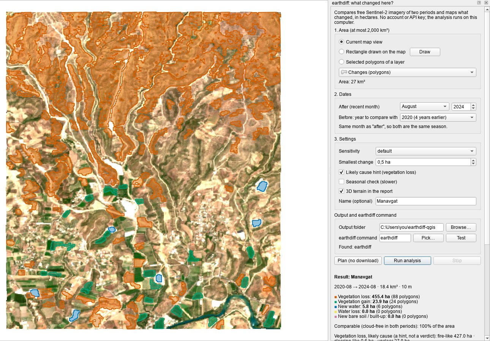

# earthdiff for QGIS

**What changed here?** A QGIS panel for [earthdiff](../README.md): pick an area and two dates, and earthdiff compares free
Sentinel-2 imagery of the two periods. The change polygons, a class raster and true-colour before/after images are added to
the map, styled; the numbers and every warning are shown in the panel; an offline HTML report (swipe, scene by scene, 3D)
opens with one click. No account, no API key.

**Türkçe:** [aşağıda](#türkçe)

## Install

1. **The earthdiff program.** QGIS's own Python does not have earthdiff's libraries (rasterio and friends) and installing them
   there can break QGIS, so the plugin runs the earthdiff program of a normal Python installation. One of:
   - `pip install earthdiff` in a normal Python (3.11 or newer), or `uv tool install earthdiff`, or `pipx install earthdiff`;
   - or just install [uv](https://docs.astral.sh/uv/): the plugin then runs earthdiff with `uvx` (the first start downloads
     about 200 MB once).

   The plugin finds it on `PATH`, in the usual Python `Scripts` folders and in `~/.local/bin`; you can also pick the program in
   the panel (*Output and earthdiff command*). It starts earthdiff without QGIS's own Python, GDAL and PROJ settings.
2. **The plugin.** In QGIS: *Plugins > Manage and Install Plugins*, search for **earthdiff** and install it (it is in the official
   QGIS plugin repository). Without internet access to the repository, download `earthdiff_qgis-<version>.zip` from the
   [releases](https://github.com/mveyseldelibas/earthdiff/releases) and use *Install from ZIP*. It appears under *Raster > earthdiff*
   and on the raster toolbar.

Works with QGIS 3.28 or newer and QGIS 4 (Qt 6). The interface is Turkish or English, following QGIS's language.

## Use

1. **Area** (at most 2,000 km²): the current map view, a rectangle drawn on the map, or the selected polygons of a layer. The
   panel shows the size as you go.
2. **Dates**: the "after" month, and the year to compare with. Both are the same month, so both are the same season (different
   seasons make almost everything look changed).
3. **Settings**: sensitivity, smallest change (hectares), the likely-cause hint for vegetation loss (fire-like / clearing-like /
   unclear), the optional seasonal check (harvest-like loss that repeats every year), 3D terrain for the report.
4. **Plan (no download)** lists the scenes found; **Run analysis** usually takes 1-4 minutes.

Result: a group *earthdiff · <name>* with

| Layer | What |
|---|---|
| Changes (polygons) | `changes.geojson`, one colour per class; attributes: class, area, confidence, index values before/after, likely cause |
| Change classes (raster) | `change_class.tif` on the analysis grid (UTM), paletted |
| After · <month>, Before · <month> | `after.tif`, `before.tif`: Sentinel-2 true colour on the same grid (earthdiff 0.2.1 or newer) |

and in the panel: hectares and polygons per class, the comparable (cloud-free) share, the likely-cause split, **every warning**,
and the data attribution. *Open report* opens the HTML report; *Open folder* the output folder (also `changes.xlsx`, `summary.json`).

earthdiff is a screening tool: it shows what changed, not why, and it is not an official damage assessment. Data: contains
modified Copernicus Sentinel data.

---

## Türkçe

**Burada ne değişti?** [earthdiff](../README.md) için bir QGIS paneli: bir alan ve iki tarih seçin, earthdiff iki dönemin ücretsiz
Sentinel-2 görüntülerini karşılaştırsın. Değişim poligonları, sınıf rasterı ve önce/sonra gerçek renk görüntüleri renklendirilmiş
olarak haritaya eklenir; sayılar ve bütün uyarılar panelde görünür; internetsiz HTML rapor (kaydırma, sahne sahne, 3B) tek tıkla açılır.
Hesap ya da API anahtarı gerekmez.

**Kurulum**

1. **earthdiff programı.** QGIS'in kendi Python'unda earthdiff'in kütüphaneleri (rasterio vb.) yok ve oraya kurmak QGIS'i bozabilir;
   bu yüzden eklenti normal bir Python kurulumundaki earthdiff programını çalıştırır. Şunlardan biri:
   `pip install earthdiff` (Python 3.11 ya da üstü), `uv tool install earthdiff`, `pipx install earthdiff`; ya da yalnız
   [uv](https://docs.astral.sh/uv/) kurun, eklenti earthdiff'i `uvx` ile çalıştırır (ilk açılışta bir kez yaklaşık 200 MB indirir).
   Eklenti programı `PATH`'te, olağan Python `Scripts` klasörlerinde ve `~/.local/bin`'de arar; paneldeki *Çıktı ve earthdiff komutu*
   bölümünden elle de seçebilirsiniz.
2. **Eklenti.** QGIS'te *Eklentiler > Eklentileri Yönet ve Kur* penceresinde **earthdiff** diye aratıp kurun (resmî QGIS eklenti
   deposunda). Depoya internetten ulaşılamıyorsa [sürümlerden](https://github.com/mveyseldelibas/earthdiff/releases)
   `earthdiff_qgis-<sürüm>.zip` dosyasını indirip *ZIP'ten kur* ile kurun. *Raster > earthdiff* menüsünde ve raster araç çubuğunda görünür.

QGIS 3.28 ve üstü ile QGIS 4 (Qt 6) desteklenir. Arayüz QGIS'in diline göre Türkçe ya da İngilizcedir.

**Kullanım:** alan (harita görünümü, çizilen dikdörtgen ya da bir katmanın seçili poligonları; en çok 2.000 km²), "sonra" ayı ve
karşılaştırılacak yıl (aynı ay, aynı mevsim), ayarlar, sonra *Plan (indirmeden)* ya da *Analizi çalıştır* (genellikle 1-4 dakika).
Sonuç *earthdiff · <ad>* grubunda: değişim poligonları, değişim sınıfları rasterı, önce/sonra görüntüleri; panelde sınıf başına hektar,
karşılaştırılabilir pay, olası neden dağılımı ve bütün uyarılar.

Ön tarama aracıdır: neyin değiştiğini gösterir, nedenini değil; resmî hasar tespiti değildir. Veri: Copernicus Sentinel verisi (değiştirilmiş).
